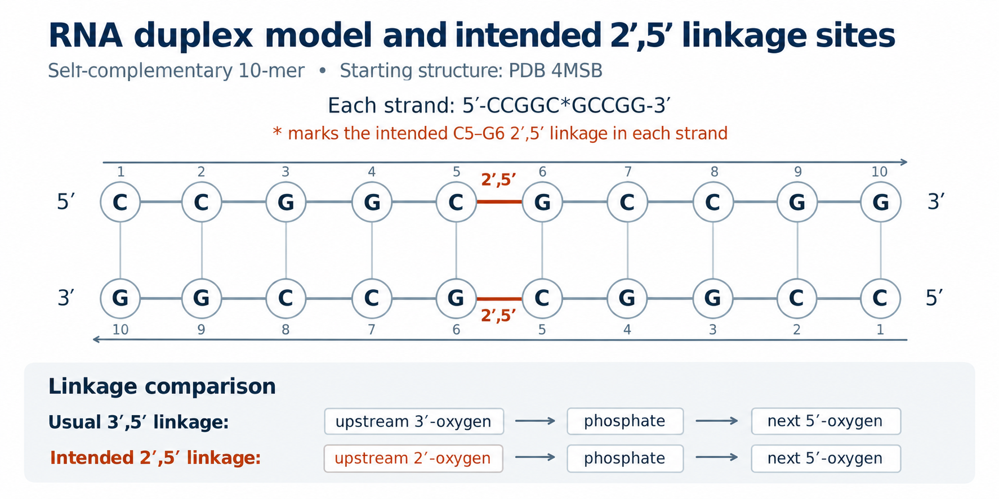

# Historical MD Research on Partially 2′,5′-Linked RNA Duplexes

## 1. Overview

This project originated in master’s research conducted by Sho Miyazaki at Tokyo Institute of Technology around 2020. It examined RNA duplexes containing selected 2′,5′ phosphodiester linkages, asking how linkage connectivity and pressure conditions relate to RNA structure and dynamics. The work involved preparing modified-cytidine residue parameters, running molecular dynamics (MD) simulations, and analyzing local structure and solvent interactions. This README introduces the historical research documented in Chapter 1 of the thesis [T].

## 2. Scientific Background

### Prebiotic RNA and backbone connectivity

The usual RNA backbone contains 3′,5′ phosphodiester linkages. Nonenzymatic RNA copying can also produce 2′,5′ linkages, making mixed backbone connectivity relevant to discussions of prebiotic RNA chemistry. Work cited in the thesis examined how such heterogeneity could coexist with RNA structure and function [1].

### Structure and stability

Earlier experiments reported reduced duplex melting temperatures for the mixed-linkage RNAs they examined [1]. Structural work by Sheng and colleagues showed that RNA duplexes can accommodate 2′,5′ linkages through local adjustments involving the modified residues and their neighbors [2]. Local backbone geometry, base-pair stacking, and ribose conformation therefore provided structural questions beyond whether a duplex could form.

### Pressure as a research motivation

A 2015 conference report on nonenzymatic nucleotide polymerization under elevated pressure contributed to the thesis’s prebiotic-chemistry motivation [3]. Separately, earlier constant-pressure MD simulations of RNA duplexes at 1 and 6,000 atm provided a computational precedent for investigating pressure-dependent RNA structure [4].

MD offered a way to follow atomic configurations over time and examine relationships among sugar conformation, local interactions, and surrounding solvent within a molecular model.

## 3. Research Questions

The project addressed three related guiding questions:

1. **Linkage and local structure:** How does introducing a 2′,5′ linkage relate to the local structure and sugar conformation of an RNA duplex?
2. **Conformation and interactions:** How are differences in sugar conformation associated with local intramolecular interactions and interactions with surrounding water molecules?
3. **Pressure and molecular behavior:** How do elevated-pressure conditions affect the structure and intermolecular interactions of partially 2′,5′-linked RNA?

## 4. Computational Approach

The following account summarizes the methods recorded in the thesis [T].

### 4.1 RNA Model

The model was a self-complementary 10-mer RNA duplex with the sequence `5′-CCGGC*GCCGG-3′` on each strand. The asterisk marks the intended 2′,5′ linkage between C5 and G6: one per strand and two per duplex. The starting coordinates were extracted from one RNA duplex among the three present in the crystallographic structure [PDB 4MSB](https://www.rcsb.org/structure/4MSB), associated with Sheng and colleagues’ study [2], as described in the thesis [T]. The thesis records that this model was selected because it had also been used in that study’s CHARMM simulations, allowing comparison with the published structural analysis. An all-3′,5′-linked duplex of the same sequence served as a linkage comparator.

*Figure A. Self-complementary RNA duplex model, showing the two intended 2′,5′ linkage positions between C5 and G6 and a conceptual comparison with standard 3′,5′ connectivity.*

### 4.2 Parameterization

Modified-cytidine residue parameters were prepared using Gaussian 16 calculations at the HF/6-31G* level, followed by electrostatic-potential-based RESP charge fitting. The preparation used models of the sugar/base and phosphate components and incorporated the resulting residue description into the initial duplex through AMBER’s structure-building workflow. RESP methodology was referenced through Cieplak and colleagues [5].

### 4.3 Force Fields and Solvation

Simulations used AMBER18 (update 5). The principal modified-RNA pressure comparisons used the OL3 RNA parameter set [6] with TIP3P water; the all-3′,5′ comparator also used OL3/TIP3P. Supplementary modified-RNA configurations examined ROC [7], YIL [8], and ff99bsc0 [9] RNA parameter sets with TIP3P, as well as OL3 with OPC [10] or TIP5P [11] water.

The systems contained 18 Na⁺ counterions for charge neutralization and an explicit-water truncated-octahedral box. The thesis describes an 8 Å solvation setting; the number of water molecules differed between configurations.

### 4.4 MD Protocol

For the principal 1 atm calculations, the recorded protocol began with 1,000 minimization steps for water and ions while restraining RNA, followed by 2,500 steps for the whole system. Staged NVT heating to 300 K occupied 4 ns, with restraints relaxed during the sequence. A further 96 ns at 1 atm under NPT conditions completed the 100 ns equilibration period. The subsequent 1,000 ns NPT interval was used for the main analyses.

Preliminary calculations and analysis-window checks preceded these longer comparisons. In particular, the `ff99bsc0` trial was examined during equilibration and was not carried into the subsequent long-trajectory sugar-pucker comparison. Short pressure-transition trials also had their own durations.

### 4.5 Pressure Conditions

The main modified-RNA pressure series comprised 1, 2,000, 4,000, and 6,000 atm. For the elevated-pressure calculations, the experimental methods section records 4 ns of NVT preparation, 3 ns of NPT equilibration at 1 atm, and 93 ns at the target pressure, followed by a 1,000 ns analysis interval at that pressure.

For 6,000 atm, preliminary tests compared a direct pressure change with a stepwise increase. The direct-change route was selected for the long calculation. The thesis describes the 2,000 and 4,000 atm calculations as following the same approach.

## 5. Analytical Scope

Trajectory analyses used CPPTRAJ [13].

### 5.1 Sugar-Pucker Analysis

Ribose conformation was described using the pseudorotation phase angle, P, calculated from the five endocyclic torsion angles. The underlying pseudorotation description follows the established treatment of Altona and Sundaralingam [12]. The thesis used the classification intervals **North-type: 0–36°** and **South-type: 144–198°** [T].

The combinations of the two modified residues’ assigned conformations were labeled NN, NS, SN, and SS. Time series, alternative analysis windows, and the first and second 500 ns portions of the selected 1,000 ns interval were examined to inform the historical analysis-window choice.

### 5.2 Structural and Solvent Interactions

The study examined local hydrogen bonds near the 2′,5′ linkage and hydrogen bonds between RNA and surrounding water, relating these analyses to sugar conformation. It also included a surface-area analysis of the modified region and neighboring residues to examine solvent exposure.

### 5.3 Pressure-Dependent Comparisons

Sugar-pucker classifications were compared across all four pressure conditions. More detailed comparisons of local hydrogen bonds, RNA–water hydrogen bonds, and the surface-area analysis focused on **1 versus 6,000 atm**. Base-pair hydrogen-bond distances were also compared between these two pressures in a separately reported 90 ns analysis.

### 5.4 Reference and Model Comparisons

The all-3′,5′ duplex provided a same-sequence comparison for investigating linkage-related behavior, including sugar conformation and RNA–water interactions at 1 and 6,000 atm. Supplementary comparisons considered published CHARMM-based structural descriptors [2], including base-pair-step geometry, and differences among the AMBER RNA parameter sets and water models.

## 6. Scope and Limitations

This README summarizes the background, aims, methods, and types of analysis used in the master’s research. Simulation results and underlying data are not included.

## 7. Credits and Acknowledgments

Sho Miyazaki carried out the master’s research, calculations, and analyses and wrote the thesis. Yoshiaki Masaki provided guidance and advice on computational chemistry and MD research. Kohji Seio provided overall research guidance and advice.

## 8. References

**[T] Historical research source.** Miyazaki, S. Master’s thesis, 2020 academic year, Tokyo Institute of Technology. Chapter 1, “異なる圧力条件下での2′,5′-シチジン残基が与えるRNA二重鎖の構造への影響,” together with the corresponding experimental methods and acknowledgments. Japanese-language thesis; no public URL is provided.

**[1]** Engelhart, A. E.; Powner, M. W.; Szostak, J. W. Functional RNAs exhibit tolerance for non-heritable 2′–5′ versus 3′–5′ backbone heterogeneity. *Nature Chemistry* **2013**, *5*, 390–394. [doi:10.1038/nchem.1623](https://doi.org/10.1038/nchem.1623).

**[2]** Sheng, J.; Li, L.; Engelhart, A. E.; Gan, J.; Wang, J.; Szostak, J. W. Structural insights into the effects of 2′-5′ linkages on the RNA duplex. *Proceedings of the National Academy of Sciences USA* **2014**, *111*, 3050–3055. [doi:10.1073/pnas.1317799111](https://doi.org/10.1073/pnas.1317799111). Associated model: [PDB 4MSB](https://www.rcsb.org/structure/4MSB).

**[3]** Rogers, K. L.; Burcar, B.; Ackerson, M.; Garbenis, E.; Watson, E. B.; McGown, L. B. Prebiotic Chemistry in High Pressure Environments. *Astrobiology Science Conference (AbSciCon)* **2015**, abstract 7429. [Official conference abstract](https://www.hou.usra.edu/meetings/abscicon2015/pdf/7429.pdf).

**[4]** Norberg, J.; Nilsson, L. Constant pressure molecular dynamics simulations of the dodecamers: d(GCGCGCGCGCGC)₂ and r(GCGCGCGCGCGC)₂. *Journal of Chemical Physics* **1996**, *104*, 6052–6057. [doi:10.1063/1.471341](https://doi.org/10.1063/1.471341).

**[5]** Cieplak, P.; Cornell, W. D.; Bayly, C.; Kollman, P. A. Application of the multimolecule and multiconformational RESP methodology to biopolymers: Charge derivation for DNA, RNA, and proteins. *Journal of Computational Chemistry* **1995**, *16*, 1357–1377. [doi:10.1002/jcc.540161106](https://doi.org/10.1002/jcc.540161106).

**[6]** Zgarbová, M.; Otyepka, M.; Šponer, J.; Mládek, A.; Banáš, P.; Cheatham, T. E., III; Jurečka, P. Refinement of the Cornell et al. Nucleic Acids Force Field Based on Reference Quantum Chemical Calculations of Glycosidic Torsion Profiles. *Journal of Chemical Theory and Computation* **2011**, *7*, 2886–2902. [doi:10.1021/ct200162x](https://doi.org/10.1021/ct200162x).

**[7]** Aytenfisu, A. H.; Spasic, A.; Grossfield, A.; Stern, H. A.; Mathews, D. H. Revised RNA Dihedral Parameters for the Amber Force Field Improve RNA Molecular Dynamics. *Journal of Chemical Theory and Computation* **2017**, *13*, 900–915. [doi:10.1021/acs.jctc.6b00870](https://doi.org/10.1021/acs.jctc.6b00870).

**[8]** Yildirim, I.; Stern, H. A.; Kennedy, S. D.; Tubbs, J. D.; Turner, D. H. Reparameterization of RNA χ Torsion Parameters for the AMBER Force Field and Comparison to NMR Spectra for Cytidine and Uridine. *Journal of Chemical Theory and Computation* **2010**, *6*, 1520–1531. [doi:10.1021/ct900604a](https://doi.org/10.1021/ct900604a).

**[9]** Pérez, A.; Marchán, I.; Svozil, D.; Šponer, J.; Cheatham, T. E., III; Laughton, C. A.; Orozco, M. Refinement of the AMBER Force Field for Nucleic Acids: Improving the Description of α/γ Conformers. *Biophysical Journal* **2007**, *92*, 3817–3829. [doi:10.1529/biophysj.106.097782](https://doi.org/10.1529/biophysj.106.097782).

**[10]** Izadi, S.; Anandakrishnan, R.; Onufriev, A. V. Building Water Models: A Different Approach. *Journal of Physical Chemistry Letters* **2014**, *5*, 3863–3871. [doi:10.1021/jz501780a](https://doi.org/10.1021/jz501780a).

**[11]** Mahoney, M. W.; Jorgensen, W. L. A five-site model for liquid water and the reproduction of the density anomaly by rigid, nonpolarizable potential functions. *Journal of Chemical Physics* **2000**, *112*, 8910–8922. [doi:10.1063/1.481505](https://doi.org/10.1063/1.481505).

**[12]** Altona, C.; Sundaralingam, M. Conformational analysis of the sugar ring in nucleosides and nucleotides. A new description using the concept of pseudorotation. *Journal of the American Chemical Society* **1972**, *94*, 8205–8212. [doi:10.1021/ja00778a043](https://doi.org/10.1021/ja00778a043).

**[13]** Roe, D. R.; Cheatham, T. E., III. PTRAJ and CPPTRAJ: Software for Processing and Analysis of Molecular Dynamics Trajectory Data. *Journal of Chemical Theory and Computation* **2013**, *9*, 3084–3095. [doi:10.1021/ct400341p](https://doi.org/10.1021/ct400341p).
